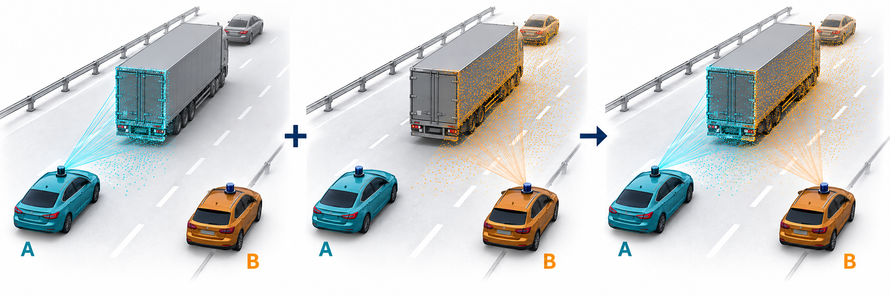

<div align="center">

<h1>Cooperative Perception with DiscoNet<br>Under Perfect Communication</h1>

<p><strong>MO809 · Topics of Distributed Computing · 2s2026</strong><br>
Luis Alberto Vásquez Vargas<br>
Presentation: November 5, 2026</p>

<p>
<a href="https://github.com/LuisAlbertoVasquezVargas/MO809-Cooperative-Perception-2s2026/raw/refs/heads/main/src/report/output/final-report.pdf"><strong>Read the report</strong></a>
&nbsp;·&nbsp;
<a href="https://github.com/LuisAlbertoVasquezVargas/MO809-Cooperative-Perception-2s2026/raw/refs/heads/main/src/slides/output/final.pdf"><strong>View the presentation</strong></a>
&nbsp;·&nbsp;
<a href="docs/EVIDENCE.md"><strong>Explore the evidence</strong></a>
</p>



<p><sub>Project illustration: complementary observations make an occluded car visible.</sub></p>

</div>

This repository is the reference archive for the MO809 final project. It brings
together the written report, final presentation, original project figures,
document sources, and the records behind the reported measurements.

The project studies a released DiscoNet student on V2X-Sim 2.0: how cooperative
feature fusion works, how sharing affects detection, how execution time scales,
and what changes when fine-resolution collaboration is restricted to a tree.

## Start here

| Material | Contents | Source |
| --- | --- | --- |
| [Final report — PDF](https://github.com/LuisAlbertoVasquezVargas/MO809-Cooperative-Perception-2s2026/raw/refs/heads/main/src/report/output/final-report.pdf) | Illustrated English report, complete results, technical walkthroughs, and references | [Report sources](src/report/) |
| [Final presentation — PDF](https://github.com/LuisAlbertoVasquezVargas/MO809-Cooperative-Perception-2s2026/raw/refs/heads/main/src/slides/output/final.pdf) | 29 delivered slides plus 83 appendix pages; 112 pages in total | [Presentation sources](src/slides/) |
| [Evidence guide](docs/EVIDENCE.md) | Direct links to the benchmark, losses, runtime sweep, tree ablation, figures, and protocols | [Measurement records](src/slides/source/assets/experiments/) |
| [Citation information](CITATION.cff) | Report citation and versioned repository reference | [BibTeX](CITATION.bib) |

The presentation keeps its original **November 5, 2026** date. The final report
has **37 pages**, including **28 numbered figures** and **11 tables**, with the architecture,
alignment/fusion sequence, worked metrics, synchronized camera views, and
numerical Conv2D/Conv3D examples developed for the project.

The PDF links above follow the current `main` branch. The
[v1.0.2 release](https://github.com/LuisAlbertoVasquezVargas/MO809-Cooperative-Perception-2s2026/releases/tag/v1.0.2)
provides a fixed snapshot of these deliverables and the evidence used by the
versioned citations.

## Main results

| Experiment | Recorded result | Evaluation scope |
| --- | --- | --- |
| Sharing disabled → enabled | AP@0.5: **49.10% → 70.41%**; AP@0.7: **43.05% → 64.82%** | Same epoch-100 student; 1,000 test frames and 4,000 active vehicle views |
| Runtime scaling | Median full-group forward: **7.76 → 306.05 ms** for 1–20 slots | Fixed 30-frame workload; 90 timings per condition |
| Original → Tree at 15 slots | **185.05 → 99.25 ms**, a **46.4% reduction**; AP losses of **13.98 / 15.08 points** | Matched 30 ego-vehicle views, 427 reference cars |

All experiments assume synchronized observations, accurate poses, and ideal
communication. Above five slots, the workload replays the five recorded scans
and poses. Full-test AP, runtime-only measurements, and the matched tree
ablation use distinct evaluation populations; the [evidence guide](docs/EVIDENCE.md)
documents each one.

## Repository map

```text
config/                          Shared document metadata
references/                      Paper bibliography and project notes
src/report/                      Report LaTeX, table generator, and PDF
src/slides/                      Presentation LaTeX, figures, evidence, and PDFs
docs/EVIDENCE.md                  Index of citable project records
docs/REPRODUCIBILITY.md           Verification and document-build instructions
scripts/verify_evidence.py        Checksums, table consistency, and timing audit
CITATION.cff / CITATION.bib       Citation metadata
SHA256SUMS                       Checksums of the current final PDFs
```

The earlier proposal sources and PDFs are retained beside the final documents
for project history. The final deliverables are the two PDFs linked above.

## Verify and build

Python **3.11+** is sufficient for the evidence checks and table generation:

```bash
python scripts/verify_evidence.py
```

Document builds also need a LaTeX distribution with `latexmk`, pdfLaTeX, BibTeX,
Beamer, TikZ, Latin Modern, Carlito, and the table/caption packages listed in the
[build guide](docs/REPRODUCIBILITY.md). `qpdf` normalizes the final PDF exports.

```bash
python src/report/build.py --document final
python src/slides/build.py --deck final
```

The builds use the bundled figures and frozen experiment records. They perform
no model training or inference and require no original research checkout.

## Cite this deliverable

The **v1.0.2** archive provides a fixed reference for this project:

> Vásquez Vargas, L. A. (2026). *Cooperative Perception with DiscoNet under
> Perfect Communication*. MO809, 2s2026. Version 1.0.2.

[CITATION.cff](CITATION.cff) supplies GitHub's citation information, and
[CITATION.bib](CITATION.bib) contains report and repository entries. The report
cites the DiscoNet and V2X-Sim papers, official dataset documentation, and this
project repository. Detailed experimental records and figure provenance are
supporting materials listed in the [evidence index](docs/EVIDENCE.md).
See the [release](https://github.com/LuisAlbertoVasquezVargas/MO809-Cooperative-Perception-2s2026/releases/tag/v1.0.2)
for the downloadable PDFs and checksums.

## Scientific sources and credits

- **DiscoNet:** Li et al., [Learning Distilled Collaboration Graph for Multi-Agent Perception](https://arxiv.org/abs/2111.00643), NeurIPS 2021.
- **V2X-Sim:** Li et al., [Multi-Agent Collaborative Perception Dataset and Benchmark for Autonomous Driving](https://arxiv.org/abs/2202.08449).
- **Reference implementation and prepared data:** [CoPerception](https://github.com/coperception/coperception) and its [V2X-Sim documentation](https://coperception.readthedocs.io/en/latest/datasets/v2x_sim/).
- Project illustrations, measured figures, and imported snapshots retain their
  source records and credits. See [NOTICE.md](NOTICE.md) and the [figure index](docs/EVIDENCE.md#figures-and-technical-material).
